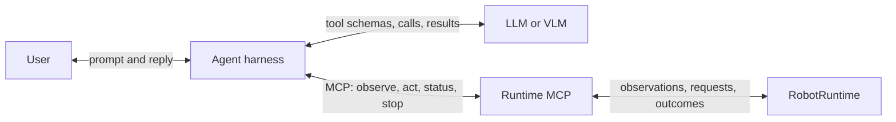

# Robot agent harness

Use an existing MCP client, or build a small harness when the application
needs its own model selection, approvals, or UI. Neither path requires a
custom RobotGraph.



## Use an existing client

The operator starts Runtime MCP. Add its endpoint to the client; for example,
in OpenCode once the proposed server exists:

```bash
opencode mcp add robot --url https://robot-host.example/mcp
opencode mcp list
```

> In simulation, run the configured pick policy. Show me the wrist camera
> while it runs, and tell me when the run finishes.

The client discovers the tools and calls `act(name="run_pick")`, `observe`,
and `status(request_id=...)`. If the user asks to stop early, it calls `stop`.
See the [tool calls and Runtime setup](examples/mcp-runtime.md).

## Build a small harness

Sketch: `mcp` is a connected, initialized client session. `model` adapts a
provider's tool-calling API; it converts MCP tool schemas and results into the
model's format, preserving images for a VLM.

```python
async def run_task(prompt, *, model, mcp, allow_call, max_turns=12):
    tools = [
        tool for tool in (await mcp.list_tools()).tools
        if tool.name in {"observe", "act", "status", "stop"}
    ]
    available = {tool.name for tool in tools}
    history = [UserMessage(prompt)]

    for _ in range(max_turns):
        turn = await model.next_turn(history, tools=tools)
        history.append(turn)
        if not turn.tool_calls:
            return turn.text

        for call in turn.tool_calls:
            if call.name not in available or not await allow_call(call):
                result = ToolError("Call not allowed")
            else:
                result = await mcp.call_tool(call.name, call.arguments)
            history.append(ToolResult(call_id=call.id, result=result))

    return "Turn limit reached; check the Runtime session status."
```

- **Harness:** tool allowlist, approvals, model history, and turn limit.
- **Runtime MCP:** validate requests and permissions independently of the harness.
- **RobotRuntime:** execute and stop the run. Ending the chat or exhausting the
  turn limit does not stop a robot run. Don't blindly retry `act` after a timeout.
