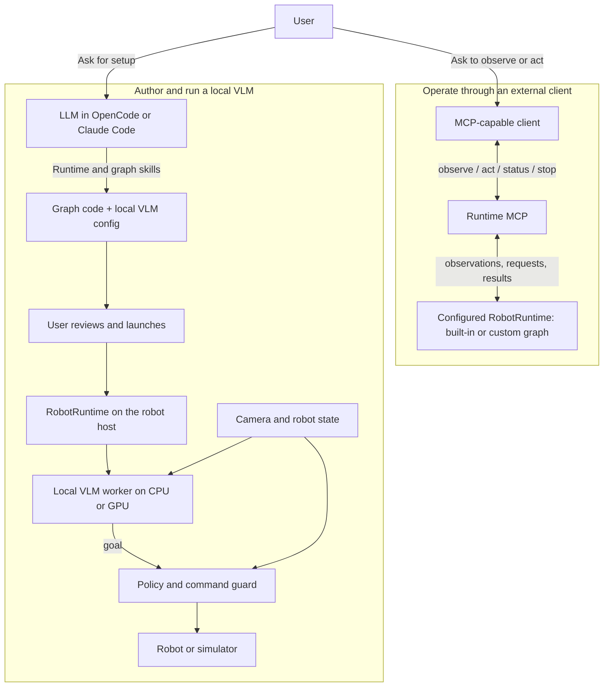

# Agentic Runtime

This is the proposed agentic layer, not a feature of the standalone RobotGraph executor. The current [demos](../proposal/demos/README.md) exercise execution and transport only; the graph-backed Runtime, local VLM node, and MCP tools below are not implemented here.

**Author:** give the model skills to write a Runtime or graph using existing
components. Generate a camera adapter or robot plugin only if one is missing.
**Run:** put the VLM in the graph on its own worker, or connect an external
agent through MCP.

| Surface                                               | API / output                                            |
| ----------------------------------------------------- | ------------------------------------------------------- |
| [Authoring](authoring.md)                             | Skills → reviewable Python, config, and tests           |
| [VLM in the graph](examples/vlm-node.md)              | Asynchronous goal source; no MCP required               |
| [Runtime MCP](runtime-mcp.md)                         | External harness: `observe`, `act`, `status`, `stop`    |
| [Robot agent harness](harness.md)                     | Connect an existing client or build the model/tool loop |
| [MCP without a custom graph](examples/mcp-runtime.md) | Start and observe a configured Runtime policy           |
| [MCP simulation example](examples/sim-task.md)        | Full graph with observation, goal, and result endpoints |

## User workflows

- **Authoring:** OpenCode, Claude Code, or any LLM client that can work with
  the project. Perplexity or a chat-only client can draft code for the user to apply.
- **External operation:** OpenCode, Claude Code, Perplexity, or another client
  when its chosen product supports and is configured for the Runtime MCP endpoint.
- **Local operation:** The authoring LLM configures a local VLM artifact and
  inference backend. The VLM runs inside the graph; no client or MCP connection
  is needed after launch.

RobotRuntime owns execution, timing, and stopping. See the
[RobotGraph API](../robotgraph-docs/overview.md).
