# RobotGraph demos

Each demo has a run command in its top docstring. The screenshots are cropped from real [Perfetto](https://ui.perfetto.dev) traces: two inference requests per model demo, or the whole run for the counter. Open the JSON generated by a model demo to zoom in or inspect a span. The screenshots have different time scales.

Solid arrows are graph edges. Dashed arrows show handoffs outside the local graph scheduler.

## 1. Counter and fan-out

[`robotgraph_demo.py`](robotgraph_demo.py) — A 4 Hz counter feeds two 2 Hz recorders. Both read the latest value on their own ticks and print `1`, then `3`.

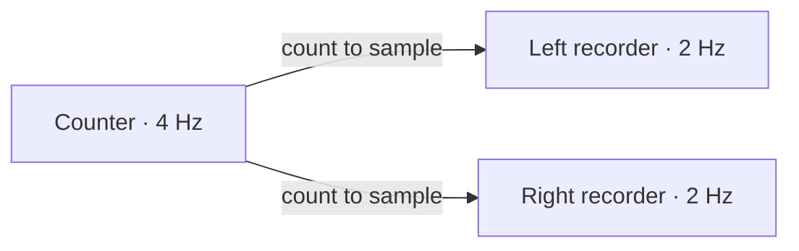

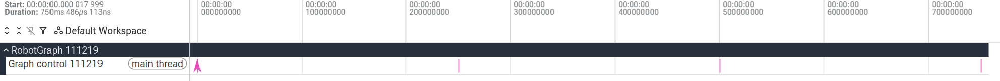

_The steps are short, so they appear as marks at roughly 0, 250, 500, and 750 ms. Tracing was enabled for this capture; the plain script prints the values._

## 2. Synchronous inference

[`robotgraph_sync_trace_demo.py`](robotgraph_sync_trace_demo.py) — Camera reads, robot state reads, policy, and robot sends target 30 Hz on one thread. The policy checks its queue before popping an action. When fewer than four actions remain, it runs the model inline and replaces the old tail with a new eight-action chunk.

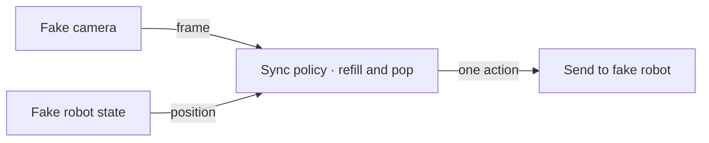

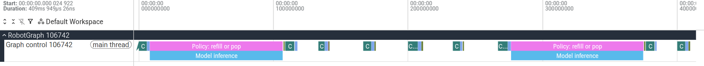

_The two ~99 ms inference spans block the control thread. On a refill tick, the robot send waits for the model._

## 3. Asynchronous inference

[`robotgraph_async_trace_demo.py`](robotgraph_async_trace_demo.py) — The same control graph and refill threshold, but after one local warmup the policy hands each refill request to a background worker. It keeps sending queued actions while one request is in flight.

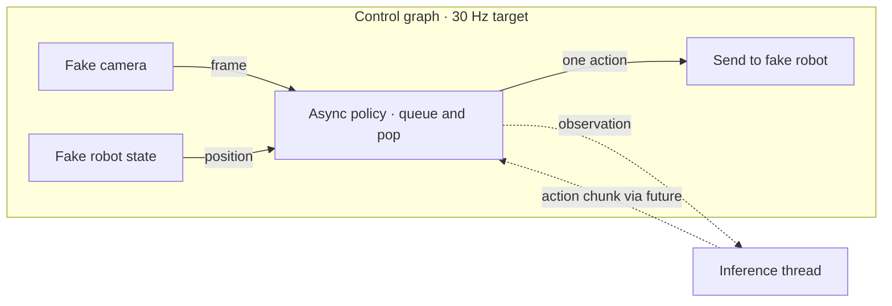

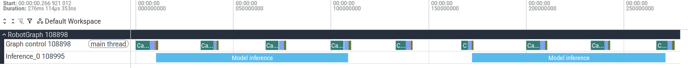

_After warmup, two ~99 ms model calls overlap camera reads, state reads, and sends on the control thread._

## 4. Zenoh within one process

[`robotgraph_zenoh_trace_demo.py`](robotgraph_zenoh_trace_demo.py) — The async policy uses two Zenoh peers in one process. A client worker sends observations over a private Unix socket, and the server callback runs the model and replies with a chunk.

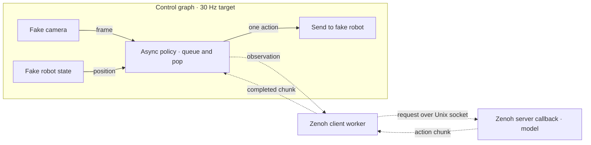

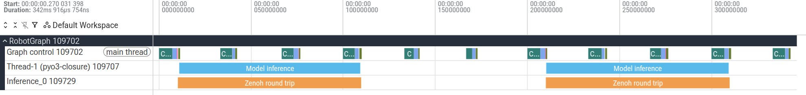

_The round trips are 99.5 and 100.0 ms in this run. They include the model call, not just transport._

## 5. Shared rings between threads

[`robotgraph_ring_trace_demo.py`](robotgraph_ring_trace_demo.py) — The control and inference threads share two bounded in-memory rings: one for observations, one for action chunks. The control thread polls for replies without blocking. Nothing is serialized or sent across a process boundary.

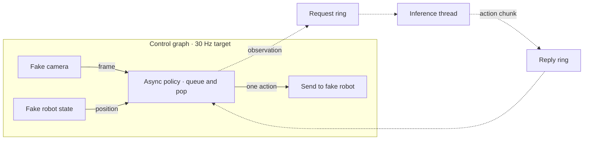

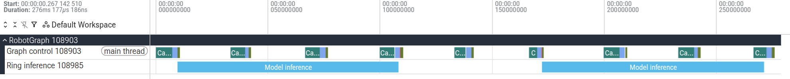

_The `Ring inference` lane runs two ~99 ms calls while the control lane continues ticking._

## 6. Two graphs in two processes over Zenoh

[`two_process/zenoh_two_process_demo.py`](two_process/zenoh_two_process_demo.py) — Each process compiles its own graph. The control process owns the action queue, and the inference process owns the model. The first chunk comes from the inference process too; there is no local model warmup. See the [startup overview](two_process/README.md).

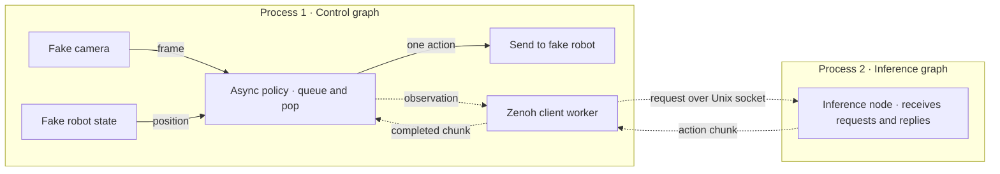

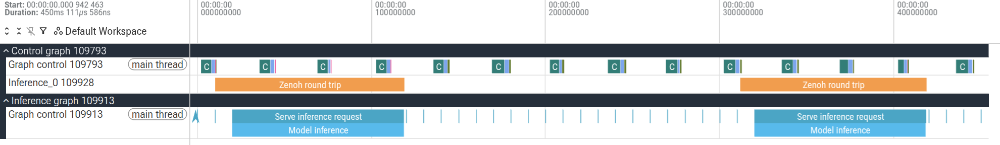

_The model takes about 99 ms. The two round trips take about 109 and 107 ms, including the wait for the inference graph to pick up each request. The control graph keeps reading while waiting for the first chunk and sends actions while later requests are in flight._
