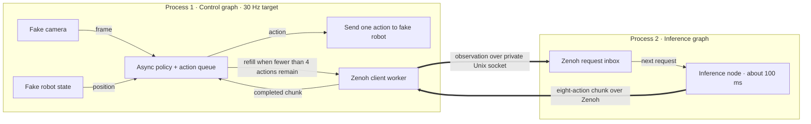

# Two RobotGraphs over Zenoh

One Python file runs both roles. The control process starts a second Python process for inference. Each process compiles and executes its own graph.

The model runs only in the inference process. The control graph keeps reading while waiting for the first chunk, then sends one queued action per control tick. Neither process needs a Zenoh router.

Run [the demo](zenoh_two_process_demo.py) using the command in its docstring, then open `robotgraph-two-process-trace.json` in [Perfetto](https://ui.perfetto.dev) to see both processes on the same timeline.
